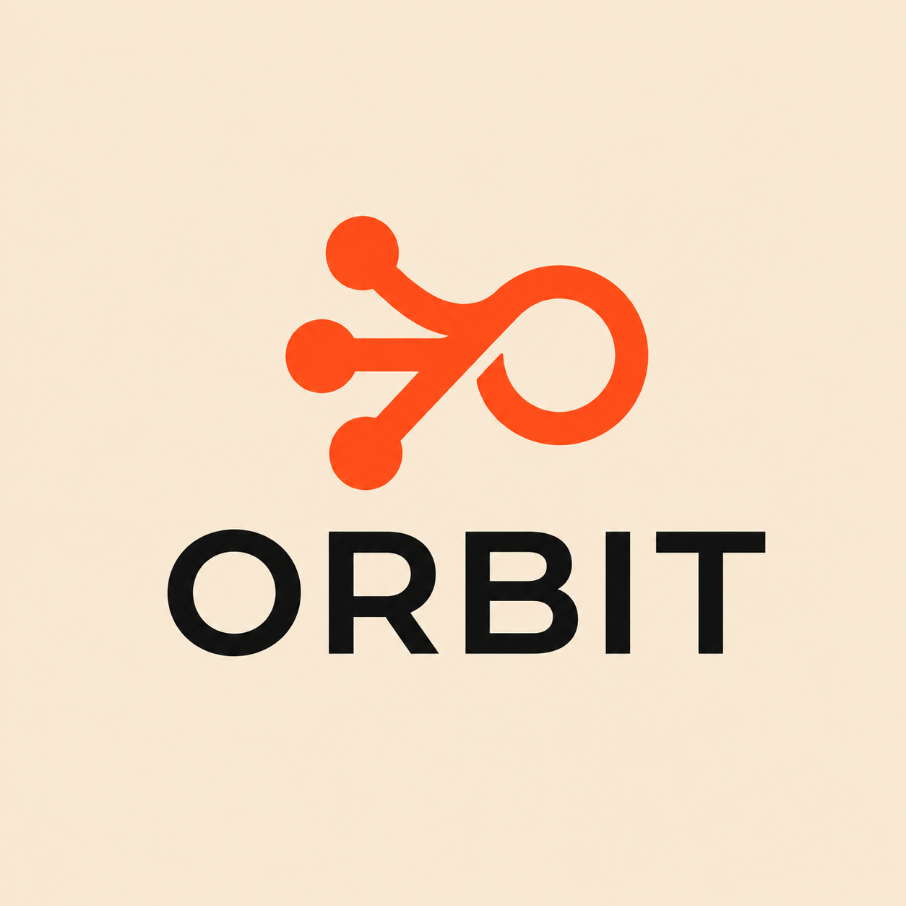
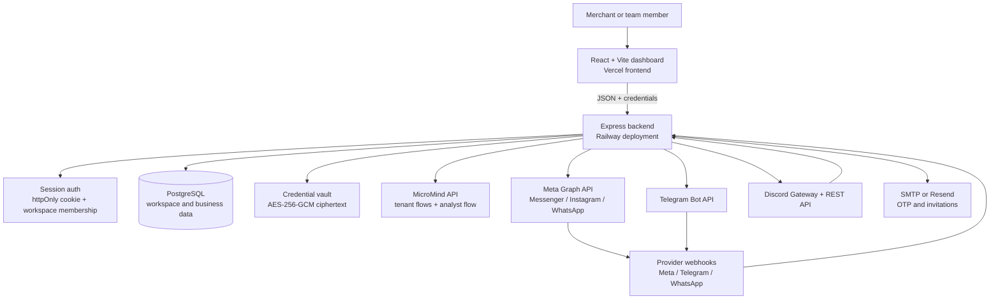

# 🛰️ ORBIT — AI Omnichannel Sales & Booking Platform  
<p align="center">
  
</p>


<div align="center">


**Every conversation. One inbox. Always awake.**

[Web application](https://orbit-xi-one-60.vercel.app) •
[Backend health endpoint](https://omnichat-production-65a3.up.railway.app/api/health) •
[MicroMind API notes](MICROMIND_API.md) •
[Security notes](SECURITY.md)

</div>

---

## 📖 Executive Summary

**ORBIT** is a web-based customer-conversation platform for merchants and service businesses in Egypt and the wider MENA region. It brings conversations from supported messaging channels into one workspace and connects those conversations to catalog management, orders, appointments, knowledge-grounded AI replies, analytics, and human takeover.

The project addresses a practical operational problem: customer questions, cash-on-delivery orders, bookings, and follow-ups are often spread across several social and messaging applications. ORBIT provides a React/Vite dashboard for business teams and an Express control plane that owns authentication, workspace access, provider credentials, webhook intake, database persistence, and routing to the MicroMind AI/execution layer.

The browser communicates with ORBIT’s backend rather than calling provider APIs or MicroMind directly. PostgreSQL stores workspace, customer, conversation, catalog, booking, knowledge, authentication, and integration state. Provider credentials are encrypted by the backend before persistence, and incoming events are resolved to the appropriate workspace and channel account.

## 🌟 Key Innovations & Core Features

### 1. 💬 Unified Conversation Workspace

The dashboard combines customer conversations into a single inbox with:

- Channel-aware conversation lists and threads
- Unread counts, customer context, and conversation status
- AI-handling and human-takeover states
- Human replies sent through the backend to the connected provider
- Customer, order, and booking context alongside the conversation

The frontend includes dedicated views for the overview, inbox, customers, orders, appointments, products, services, automations, scheduler, knowledge, analytics, settings, and administration.

### 2. 🤖 Knowledge-Grounded AI Assistance

ORBIT uses MicroMind flows for channel-specific AI interactions and a shared analyst path for knowledge questions and reports. Workspace knowledge can be added as:

- FAQs
- Policies
- Product or service notes
- General business notes
- Uploaded `.txt`, `.md`, `.csv`, `.json`, `.pdf`, and `.docx` files

Uploaded documents are parsed on the backend, normalized, and split into chunks of approximately 4,000 characters, with a maximum of 25 chunks per upload. Knowledge questions first use the MicroMind analyst; if that service is unavailable, the backend performs a local keyword match and reports the answer source as `micromind`, `local-match`, or `none`.

### 3. 🔌 Multi-Channel Connections

The channel connection layer supports different integration paths:

| Channel | Current implementation status |
|---|---|
| Messenger | Verified template and automatic tenant-flow provisioning |
| Instagram | Verified template and automatic tenant-flow provisioning |
| Telegram | Bot connection, webhook registration, inbound parsing, and replies |
| Discord | Bot connection, gateway-based inbound messages, and REST replies |
| WhatsApp | Provider wiring and webhook path present; BYOF flow required while the template is pending |
| Gmail | Connection seam and webhook route present; Google OAuth and Pub/Sub are not configured |
| TikTok | Not implemented |

Meta Messenger and Instagram use OAuth and Meta Graph integration. Telegram uses a Bot API webhook with a per-account secret. Discord receives messages through its gateway because Discord does not provide a per-message inbound webhook.

### 4. 🧠 Isolated AI Flows per Workspace and Channel

The provisioning layer follows a workspace-and-channel tenancy model. A connected channel can receive its own MicroMind folder, flow, and prediction-key relationship. The backend also supports bring-your-own-flow connections by accepting a MicroMind flow ID and flow key where the channel template is not yet verified.

Inbound identity is kept deterministic with a workspace/channel/sender-based session identifier, so conversations do not depend on a randomly generated flow memory ID.

### 5. 🛍️ Commerce and Booking Operations

The application supports both commerce and service workflows:

- Product catalog with pricing, stock, categories, SKUs, images, variants, and availability
- Service catalog with pricing, duration, descriptions, categories, and availability
- Cash-on-delivery orders with status, address, governorate, payment method, and AI confirmation state
- Customer records with channel information, order counts, total spend, tags, and reliability data
- Appointment records with service, date, time, duration, status, assigned professional, and notes
- Content schedules and publish-now support for supported connected channels

### 6. 📊 Analytics and Executive Reports

Analytics surfaces conversation volume, channel activity, response handling, buying intent, and other workspace metrics. The backend can generate summary reports from stored business data and use the analyst path for natural-language reporting. Reports are persisted in PostgreSQL for later review.

### 7. 👥 Workspace Collaboration

Workspace membership uses roles including `owner`, `admin`, and `agent`. Owners can invite team members by email, assign roles, revoke pending invitations, and manage workspace access. Invitation tokens are random, stored as hashes, expire after seven days, and are single-use.

### 8. 🧪 Offline Dummy Mode

The frontend includes a local dummy-data mode for UI exploration without a backend:

```text
https://orbit-xi-one-60.vercel.app/?dummy=1
```

Dummy mode loads the frontend’s sample state and does not represent live workspace data or provider connectivity.

---

## 🏗️ System Architecture



The frontend is deployed separately from the Express server. In local development, Vite proxies `/api` and `/webhooks` to `http://localhost:5000`. In the configured Vercel deployment, `vercel.json` rewrites those paths to the Railway backend.

The server is the control plane: it authenticates requests, resolves workspace membership, retrieves encrypted provider credentials, handles inbound events, calls MicroMind, persists normalized messages, and sends provider replies. Provider secrets are not intended to be returned to the frontend.

## 🔬 Technical and Scientific Foundations

ORBIT combines deterministic business logic with external AI inference. These responsibilities are intentionally separate:

| Concern | Implementation | Behavior |
|---|---|---|
| Authentication | bcrypt password hashes and server-side session rows | Deterministic validation of credentials and session expiry |
| Workspace authorization | Membership lookup plus owner/admin role checks | Client-supplied workspace IDs are accepted only when membership is verified |
| Credential storage | AES-256-GCM envelope encryption | Provider secrets are encrypted before persistence and decrypted only for outbound provider calls |
| Channel routing | Channel account, provider identifiers, webhook verification, and workspace state | Deterministic routing of events to a workspace |
| AI response | MicroMind prediction flow | External model/flow behavior, configured per channel or analyst use case |
| Knowledge fallback | Local keyword scoring over FAQs and knowledge items | Deterministic fallback when the analyst service is unavailable |
| File processing | Text extraction followed by bounded chunking | Deterministic parsing and storage of retrievable knowledge items |

The backend does not claim that every response is generated by machine learning: knowledge answers explicitly expose whether the response came from MicroMind, a local match, or no available source.

## 📂 Repository Structure

```text
omnichat/
├── src/
│   ├── app/                         # Onboarding and authenticated shell UI
│   ├── components/                  # Inbox, commerce, appointments, settings, and shared UI
│   ├── pages/                       # Dashboard, auth, legal, analytics, and admin pages
│   ├── services/
│   │   └── api.ts                   # Frontend API client and session-cookie requests
│   ├── state/                       # Store, vertical context, and dummy data
│   ├── styles/                      # Global styles and design tokens
│   ├── App.tsx                      # Public routes, session guard, onboarding, dashboard routes
│   └── main.tsx                     # React entry point
├── server/
│   ├── auth/                        # Signup OTP, login, reset, sessions, and authorization
│   ├── channels/                    # Connection, OAuth, diagnostics, and channel lifecycle
│   ├── integrations/                # Telegram, Discord, and Gmail provider adapters
│   ├── meta/                        # Meta OAuth, Graph API, webhooks, and conversations
│   ├── micromind/                   # AI client, analyst, provisioning, keys, and templates
│   ├── knowledge/                   # Knowledge CRUD, uploads, parsing, and AI questions
│   ├── admin/                       # Workspace diagnostics, users, templates, usage, and replay
│   ├── billing/                     # Plan limits and workspace usage reporting
│   ├── migrations/                  # Ordered PostgreSQL migrations
│   ├── schema.sql                   # Base PostgreSQL schema
│   ├── db.js                        # PostgreSQL pool and connection health
│   ├── initDb.js                    # Base schema and migration bootstrap
│   ├── migrate.js                   # Idempotent migration runner
│   └── index.js                     # Express application and legacy API routes
├── mcp-micromind/                   # Standalone MCP server for MicroMind operations
├── scripts/                         # Owner bootstrap, probes, sanitization, and verification tools
├── .github/workflows/keepwarm.yml   # Scheduled backend health check
├── .env.example                     # Configuration template
├── vercel.json                      # Vercel frontend build and API rewrites
├── vite.config.ts                   # Vite, Vitest, dev proxy, and test environment
├── package.json                     # Scripts and dependencies
├── MICROMIND_API.md                 # Verified MicroMind contract and integration notes
├── ORBIT Description.md             # Product scope and supported workflows
├── SECURITY.md                      # Security review and known limitations
└── HANDOVER.md                      # Operational handover notes
```

## ⚡ Quick Start & Installation

### Prerequisites

- Node.js and npm
- A reachable PostgreSQL database
- Git
- MicroMind credentials and flow configuration for AI-backed operation
- Provider credentials only for the channels you intend to connect

### 1. Clone and install

```bash
git clone https://github.com/micromindomnichannel/omnichat.git
cd omnichat
npm ci
cp .env.example .env
```

On Windows, copy `.env.example` to `.env` using File Explorer or PowerShell. The application reads `.env` from the repository root.

### 2. Configure PostgreSQL

Set either `DATABASE_URL` or the individual `DB_*` variables in `.env`. For a new database, initialize the base schema and apply migrations:

```bash
npm run db:init
```

`db:init` creates the base tables, applies the ordered migrations, and seeds the default business setting. For an existing installation or a later deployment, apply only pending migrations with:

```bash
npm run db:migrate
```

### 3. Create the first owner

The owner bootstrap script runs migrations and creates an owner in the `default` workspace:

```bash
node scripts/create-owner.mjs --email=you@example.com --password='<10+ characters>' --name='Your Name'
```

The password must contain at least 10 characters. After the first owner exists, normal self-service signup uses email OTP verification and new accounts receive their own workspace.

### 4. Start the backend

```bash
npm run server
```

The Express API listens on port `5000` by default, or on the value of `PORT`.

### 5. Start the frontend

In a second terminal:

```bash
npm run dev
```

The Vite development server listens on port `3000`. Open `http://localhost:3000`.

### 6. Optional local checks

```bash
node test_db.cjs
npm run probe:micromind
node scripts/verify-links.mjs
node scripts/verify-otp.mjs
```

The database and MicroMind probes require the relevant local configuration unless the script explicitly supplies its own stubs.

## ⚙️ Configuration and Environment Variables

Copy `.env.example` to `.env`. Keep backend-only secrets out of frontend source and do not expose them through `VITE_*` variables.

### Database and server

| Variable | Purpose |
|---|---|
| `DATABASE_URL` | Preferred PostgreSQL connection URI |
| `DB_HOST`, `DB_PORT`, `DB_USER`, `DB_PASSWORD`, `DB_NAME` | PostgreSQL connection fields when `DATABASE_URL` is not used |
| `PGSSLMODE` | Set to `require` for managed PostgreSQL providers that require TLS |
| `PORT` | Express listening port; defaults to `5000` |
| `CORS_ORIGIN` | Comma-separated browser origins allowed by the backend |
| `ORBIT_BACKEND_URL` | Public backend URL used in provider webhook setup and uploaded image URLs |
| `ORBIT_FRONTEND_URL` | Public frontend URL used by OAuth redirects, reset links, and invitations |

### Authentication, cookies, and email

| Variable | Purpose |
|---|---|
| `CRED_KEY` | Required in production: a 64-character hexadecimal AES-256 vault key |
| `SESSION_TTL_HOURS` | Absolute server-side session lifetime; defaults to 12 hours |
| `COOKIE_SAMESITE` | Cookie policy; cross-site production deployments generally need `None` |
| `COOKIE_SECURE` | Set to `1` when cookies must include `Secure` |
| `SMTP_HOST`, `SMTP_PORT`, `SMTP_USER`, `SMTP_PASS`, `SMTP_FROM` | SMTP delivery for signup OTPs and invitations |
| `SMTP_SECURE` | Enables secure SMTP transport when set to `true` |
| `RESEND_API_KEY`, `RESEND_FROM` | Optional Resend HTTPS email delivery |

Generate a vault key locally with:

```bash
node -e "console.log(require('crypto').randomBytes(32).toString('hex'))"
```

Development-only flags such as `ALLOW_DEBUG_OTP=1` and `ALLOW_DEBUG_RESET=1` can expose verification material to local flows. Do not enable them for a public or production deployment.

### MicroMind and provider integrations

| Variable | Purpose |
|---|---|
| `MICROMIND_BASE_URL` | MicroMind API base URL |
| `MICROMIND_API_KEY` | Backend management/API-key fallback |
| `MICROMIND_MESSENGER_FLOW_ID` | Reference or fallback flow ID |
| `MICROMIND_ANALYST_FLOW_ID`, `MICROMIND_ANALYST_API_KEY` | Shared analyst flow configuration |
| `MICROMIND_PROVISIONER_EMAIL`, `MICROMIND_PROVISIONER_PASSWORD` | Management identity for tenant provisioning |
| `MICROMIND_GROQ_CREDENTIAL_ID`, `MICROMIND_OPENROUTER_CREDENTIAL_ID` | Shared credential references for tenant flow templates |
| `META_APP_ID`, `META_APP_SECRET` | Meta Login / Business Login credentials |
| `META_OAUTH_REDIRECT_URI`, `META_OAUTH_REDIRECT_URI_MESSENGER`, `META_OAUTH_REDIRECT_URI_INSTAGRAM` | Registered Meta OAuth callback URLs |
| `META_OAUTH_SCOPES`, `META_GRAPH_VERSION` | Requested Meta permissions and Graph API version |

Provider bot tokens, page tokens, flow keys, and similar secrets are entered through the backend connection flows and stored in the credential vault. They should not be committed to `.env.example`, source code, logs, or documentation.

### Frontend API URL

Set this in the frontend environment when the API is not reachable through the Vite proxy or the Vercel rewrites:

```dotenv
VITE_API_URL=http://localhost:5000/api
```

## 📡 API Reference

### Base URLs

| Environment | URL |
|---|---|
| Local API | `http://localhost:5000/api` |
| Configured production API | `https://omnichat-production-65a3.up.railway.app/api` |
| Configured frontend | `https://orbit-xi-one-60.vercel.app` |

The backend uses an `orbit_session` httpOnly cookie. Public routes are limited to health, authentication, OAuth callbacks, invite lookup/acceptance, and provider webhooks. Most application and `/api/v1` routes require a valid session and workspace membership.

### Authentication

| Method | Endpoint | Auth | Description |
|---|---|---|---|
| `POST` | `/auth/signup/request-code` | Public | Create an email OTP signup request |
| `POST` | `/auth/signup/verify` | Public | Verify the six-digit OTP and create a session |
| `POST` | `/auth/login` | Public | Authenticate with email and password |
| `POST` | `/auth/logout` | Session | Destroy the current session |
| `GET` | `/auth/me` | Session | Return the current user and workspace memberships |
| `POST` | `/auth/forgot` | Public | Request a password-reset email without account enumeration |
| `POST` | `/auth/reset` | Public | Set a new password with a reset token |
| `DELETE` | `/auth/account` | Session | Delete the user, sessions, memberships, and reset artifacts |

Example:

```bash
curl -i -c cookies.txt \
  -H "Content-Type: application/json" \
  -d '{"email":"you@example.com","password":"YOUR_10_CHAR_PASSWORD"}' \
  http://localhost:5000/api/auth/login

curl -b cookies.txt http://localhost:5000/api/auth/me
```

### Core application API

| Method | Endpoint | Auth | Description |
|---|---|---|---|
| `GET` | `/health` | Public | Backend and PostgreSQL connectivity status |
| `GET` | `/bootstrap` | Session | Load the main workspace dashboard payload |
| `GET/POST/PUT/DELETE` | `/products[/:id]` | Session | Manage products |
| `GET/POST/PUT/DELETE` | `/services[/:id]` | Session | Manage services |
| `GET/PUT` | `/customers[/:id]` | Session | List and update customers |
| `GET/PUT` | `/conversations[/:id/status]` | Session | List conversations and update status |
| `POST` | `/messages` | Session | Add a message to a conversation |
| `GET/POST/PUT` | `/orders[/:id]` | Session | Manage orders |
| `POST` | `/orders/ai-confirm` | Session | Confirm an order through the application flow |
| `GET/POST/PUT` | `/appointments[/:id]` | Session | Manage appointments |
| `POST` | `/automations/:id/toggle` | Session | Toggle an automation |
| `GET/POST/DELETE` | `/faqs[/:id]` | Session | Manage FAQs |
| `GET/POST/DELETE` | `/schedules[/:id]` | Session | Manage scheduled content |
| `GET/POST` | `/reports[/generate]` | Session | Read or generate reports |
| `GET/PUT` | `/settings` | Session | Read or update business settings |
| `POST` | `/upload` | Session | Validate and store a JPEG, PNG, GIF, or WEBP image |

Example health response shape:

```json
{
  "status": "online",
  "timestamp": "2026-01-01T00:00:00.000Z",
  "commit": "local",
  "database": {
    "connected": true,
    "host": "your-postgres-host",
    "port": "5432",
    "name": "omnichannel"
  }
}
```

### Versioned integration API

| Method | Endpoint | Auth | Description |
|---|---|---|---|
| `GET` | `/v1/workspaces/:workspaceId/channels` | Session + membership | List safe channel-account fields |
| `POST` | `/v1/workspaces/:workspaceId/channels/:channel/connect` | Session + membership | Connect a provider channel |
| `POST` | `/v1/workspaces/:workspaceId/channels/:channel/oauth/start` | Session + membership | Start Meta OAuth |
| `GET` | `/v1/channels/:channel/oauth/callback` | OAuth callback | Complete Meta OAuth |
| `POST` | `/v1/channels/:id/disconnect` | Session + membership | Disconnect a channel |
| `POST` | `/v1/channels/:id/reconnect` | Session + membership | Reconnect a channel |
| `POST` | `/v1/channels/:id/test` | Session + membership | Test a channel flow |
| `POST` | `/v1/conversations/:id/reply` | Session + membership | Send a human reply through the provider |
| `GET` | `/v1/conversations/:id/messages` | Session + membership | Load a conversation thread |
| `GET/POST/DELETE` | `/v1/workspaces/:workspaceId/knowledge[/:id]` | Session + membership | Manage knowledge items |
| `POST` | `/v1/workspaces/:workspaceId/knowledge/upload` | Session + membership | Parse and chunk a knowledge file |
| `POST` | `/v1/workspaces/:workspaceId/knowledge/ask` | Session + membership | Ask the knowledge base |
| `GET` | `/v1/workspaces/:workspaceId/plan` | Session + membership | Read plan limits and 30-day usage |
| `GET/POST/DELETE` | `/v1/workspaces/:workspaceId/invites` and `/v1/invites/:id` | Role-restricted | Manage workspace invitations |

Knowledge question example:

```bash
curl -b cookies.txt \
  -H "Content-Type: application/json" \
  -d '{"question":"What is our return policy?"}' \
  http://localhost:5000/api/v1/workspaces/default/knowledge/ask
```

Possible response shape:

```json
{
  "answer": "The answer found in the workspace knowledge base.",
  "source": "micromind"
}
```

`source` may be `micromind`, `local-match`, or `none`.

### Provider webhooks

| Method | Endpoint | Auth or verification | Description |
|---|---|---|---|
| `GET` | `/webhooks/messenger` | Meta verification query | Meta webhook handshake |
| `POST` | `/webhooks/messenger` | Meta signature when configured | Messenger inbound events |
| `GET/POST` | `/webhooks/instagram` | Meta verification/signature | Instagram events |
| `GET/POST` | `/webhooks/whatsapp` | Meta verification/signature | WhatsApp events |
| `POST` | `/webhooks/telegram` | Telegram secret token | Telegram updates |
| `POST` | `/webhooks/gmail` | Not operational | Returns the Gmail pending behavior |

## 🧭 Usage Examples

### First workspace setup

1. Start the backend and frontend.
2. Log in with the owner created by `scripts/create-owner.mjs`, or complete the email-OTP signup flow.
3. Select a business vertical during onboarding.
4. Connect Messenger, Instagram, Telegram, or Discord from **Settings → Channels**.
5. Add FAQs, policies, products, services, or uploaded documents under **Knowledge**.
6. Review the AI configuration and channel diagnostics.
7. Monitor incoming conversations in **Inbox**, take over when needed, and manage orders or appointments from the related drawers.

### Human takeover

The AI channel flow handles inbound messages when enabled. A team member can open a conversation, send a reply through `/api/v1/conversations/:id/reply`, and use the conversation controls to manage the AI/human handling state.

### Knowledge upload

The Knowledge page accepts supported text and document formats. The backend extracts text, rejects unsupported or empty files, limits uploads to 8 MB, and stores bounded chunks for retrieval.

### Local frontend exploration

To explore the dashboard without PostgreSQL, provider credentials, or a backend:

```text
http://localhost:3000/?dummy=1
```

This mode uses the sample data in `src/state/mockData.ts` and should not be used to validate production integrations.

## 🧪 Testing

The root project uses **Vitest** with **jsdom**, React Testing Library, and `src/test-setup.ts`. The repository contains frontend tests for pages, onboarding, shell components, inbox, settings, services, and shared UI.

Run the root test suite with:

```bash
npm test
```

Additional repository checks include:

```bash
node scripts/verify-links.mjs
node scripts/verify-otp.mjs
npm run probe:micromind
```

The standalone MCP package has its own test command:

```bash
cd mcp-micromind
npm ci
npm test
```

This README does not claim a passing test result; run the commands in the current environment to verify the present checkout.

## 🚀 Deployment

### Frontend

`vercel.json` configures the frontend for Vercel:

- Build command: `npm run build`
- Output directory: `dist`
- API and webhook rewrites point to the configured Railway backend
- All other routes fall back to `index.html` for the Vite single-page application

Build and preview locally:

```bash
npm run build
npm run preview
```

### Backend

The Express backend is started with:

```bash
npm start
```

The deployed backend must have access to PostgreSQL, `CRED_KEY`, the required CORS and cookie settings, MicroMind configuration, and any provider credentials used by connected channels. Run `npm run db:migrate` during deployment or startup to apply pending migrations.

### Scheduled availability check

`.github/workflows/keepwarm.yml` runs every ten minutes, with manual dispatch support, and checks the configured Railway `/api/health` endpoint. It retries during deployment restarts and fails when the endpoint does not report `"status":"online"`.

## 👥 Contributors and Engineering Team

The repository does not contain a maintained contributor roster or individual author list. Contributions should follow the existing separation between the React client, Express control plane, provider adapters, database migrations, and MicroMind integration layer.

## 🔒 Security, Privacy, and Important Notes

- Authentication uses bcrypt password hashing and server-side sessions. The session token is held in an httpOnly browser-session cookie, while a SHA-256 hash is stored in PostgreSQL.
- Workspace access is checked through membership rows; owner/admin routes apply role checks.
- Provider credentials are stored as AES-256-GCM encrypted envelopes using the backend-only `CRED_KEY`.
- CORS is restricted to configured browser origins, and rate limits protect login, OTP, webhook, and human-reply paths.
- Meta webhook requests retain the raw request body so signature verification can be performed when `META_APP_SECRET` is configured. Telegram checks its per-account webhook secret.
- Workspace and customer data are stored in PostgreSQL. The repository does not establish a formal regulatory compliance claim or guarantee a particular provider’s retention policy.
- The in-memory rate limiter is process-local. A multi-instance deployment would need a shared limiter such as Redis or an equivalent coordinated mechanism.
- The backend contains development fallbacks for missing credentials and mail configuration. These are not production security controls.
- `MICROMIND_API_KEY`, provider tokens, SMTP credentials, database passwords, and `CRED_KEY` must never be committed or exposed to the frontend.

## ⚠️ Disclaimer

ORBIT is a business-operations and customer-communication platform. AI-generated replies, summaries, classifications, and recommendations should be reviewed by the business and do not replace human judgment. The repository includes healthcare-oriented example terminology in parts of its catalog and vertical model, but it is not a medical device and does not provide medical, legal, or financial advice.

<div align="center">

**ORBIT connects the channels businesses already use with the operational tools they need to respond, sell, and book from one workspace.**

</div>
```
